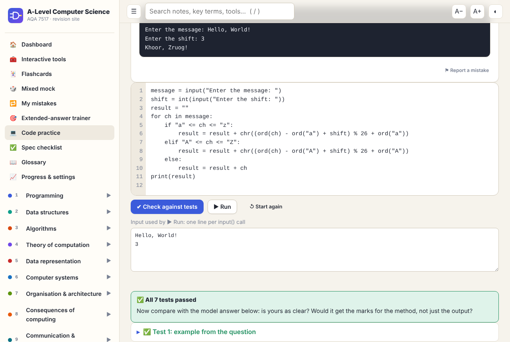
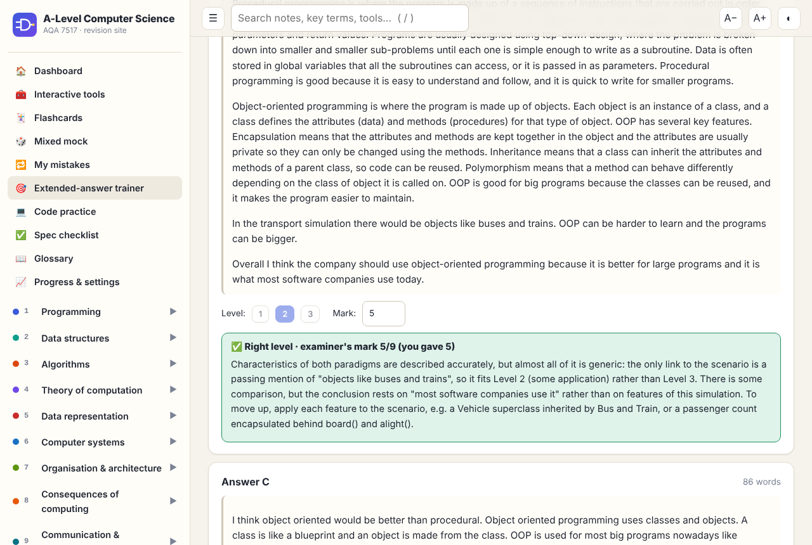
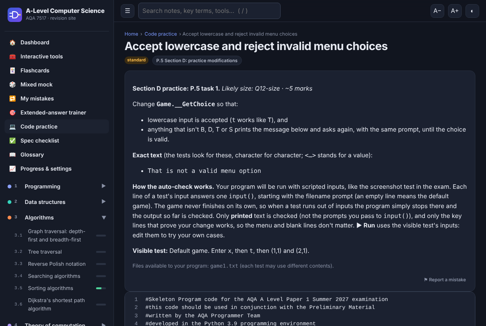

# A-Level Computer Science Revision Site (AQA 7517)

An interactive revision site covering the whole AQA A-Level Computer Science specification, used by my class. I designed it and directed AI coding agents (Claude Code) to build it. I set the requirements and quality bar, reviewed the work, and decided what shipped. Every page, question and tool was then checked by code, not taken on the AI's word.

**Live site: [h4rvb0x.github.io/computing-notes](https://h4rvb0x.github.io/computing-notes/)**


## At a glance

| | |
|---|---|
| **79 pages of notes** | Every section of the spec, with all 283 spec points mapped ([COVERAGE.md](COVERAGE.md)). Each page has key terms (mark-scheme wording plus plain English), worked examples, diagrams, common-mistake boxes and exam technique |
| **2,180 questions** | 1,585 quiz questions with instant feedback, and 595 exam-style questions self-marked against mark schemes |
| **105 Python coding problems** | Written and run in the browser against 597 visible and hidden tests |
| **41 interactive tools** | AQA assembly simulator, fetch–decode–execute stepper, logic gates, Boolean simplifier, SQL playground, floating point, Dijkstra/A*, Turing machines, FSMs, regex, subnetting, TLS… |
| **700+ flashcards and 89 trace tables** | Spaced repetition, and traces checked cell by cell |

## Features

**Learning and practice**
- **Code practice.** Python runs in the browser through Pyodide (CPython compiled to WebAssembly), with hints, model answers and hidden tests that catch edge cases. There are three sets:
  - 60 Paper 1 Section B-style problems
  - 24 exercises from my class's programming booklet
  - all 21 Section D modifications for this year's skeleton program, *Piles O' Tiles*. You edit the real program, and scripted games check that your change works and that normal play still does.
- **Extended-answer trainer.** For each of 33 levelled 6/9/12-mark questions, you mark three example answers yourself, then compare with the examiner's level, mark and comment. Then you write your own.
- **My mistakes.** Every wrong answer comes back after 1, 3 and 7 days until you've got it right each time.
- **Paper 1 skeleton section.** A method-by-method code tour, 18 documented bugs, 58 Section C questions, and a faithful in-browser copy of the game.
- **Mixed mocks, a spec checklist, search and a glossary.**

**Around it**
- **Exam countdowns** for both papers, plus your own: mocks, the NEA deadline, other subjects.
- **Accounts with live sync.** Sign in with Google, and progress on your phone appears on your laptop within seconds.
- **Installable app.** Add to Home Screen; the whole site works offline, including code practice after its first use.
- **Report a mistake** on every question and page. It goes to a Google Form, so no account is needed.
- **Dark mode, a mobile layout, adjustable text size, per-page progress reset** and a "don't save on this device" mode for shared PCs.

<p>
  
  
</p>
<p>
  
  
</p>

## How I built it with AI

The project is mainly an exercise in **getting AI agents to build something large and correct**, rather than writing every line myself.

**My role**
- **Defining the product:** what a textbook replacement needs, the page template, question types and tools, offline use, privacy, and the quality bar.
- **Supplying the inputs:** my class notes (kept private, not in this repo), the class programming booklet, the skeleton program and the exam-board constraints.
- **Making the calls:** hosting, accounts, the logo, which features to build and which to drop.
- **Running the build:** reviewing every agent's report and sending work back. I kept to at most two agents at a time to stay inside a usage budget.

**How the work was organised**
- **Specification first.** A written content contract ([docs/CONTENT_SPEC.md](docs/CONTENT_SPEC.md)) gave every agent the same formats and rules.
- **Separate builders and reviewers.** Agents owned a section of the course or a feature. A *different* agent then reviewed each piece of work without having written it.
- **Verification over trust.** Nothing was accepted because the AI said it was right:
  - **Python examples:** all 188 are run, and their output is compared with what the page shows.
  - **Answer keys:** every quiz key, trace and mark scheme was recomputed with code, using Python, `sqlite3`, regex engines, truth tables and an AQA assembly interpreter.
  - **The game copy:** the in-browser *Piles O' Tiles* was tested against the real Python program, with identical output on 61 scripted runs.
  - **Coding problems:**
    - every model answer passes its tests in real Python *and* in the browser runner;
    - every starting template fails at least one test;
    - a separate agent solved all 60 core problems using only the question wording, to find unclear tasks.
  - **Sync:** the merge rules have 23 unit tests, and the whole flow was tested against the real Firebase project (upload, a second device picking it up live, the newest edit winning, resets, and the security rules refusing access to another user's data).
  - **The whole site:** a browser test opens all 557 pages on desktop and mobile, and fails on any error or sideways scrolling.
- **Continuous checks.** GitHub Actions runs seven validators on every push and only deploys if they all pass.

**What went wrong, and how it was caught**
- **The quizzes gave answers away.** Using the site, I noticed the correct option was often just the longest one, a known habit of AI-written multiple choice.
  - **How it was measured:** a correct option more than 15% longer than every wrong one counts as a giveaway. The answer should be the longest option about as often as chance (25%).
  - **The fix:** 281 questions were rewritten, options are now shuffled, and CI fails if the bias returns.
  - **The same rule applied elsewhere:** in over half the extended-answer questions, a weaker example answer is at least as long as the best one, so length never gives the level away.
- **Questions that leaned on things they didn't show.** A classmate hit an SQL question about a database the question never displayed. A review of all 2,180 questions found 48 like it. Each now includes its own table, code or diagram, and CI rejects any question that refers to "the previous question" or "the table above" without showing it.
- **A bug that had been there from the start.** The exam pages' self-marked total joined numbers together as text once a box was ticked. It was found while testing a data migration, and fixed.
- **Over-confident facts.** An independent review of the extended-answer examples tightened legal claims (what the PSTI Act and the Automated Vehicles Act actually say), corrected a timeline and moved one answer that had been put in the wrong level.
- **A full code review before calling it finished.** A separate agent reviewed the newer code and found 15 problems that every test had passed. The worst were three ways sync could lose work: an old reset wiping a device that had never synced, an out-of-date draft overwriting a newer one, and a restored backup being thrown away. There was also a shared school PC staying signed in to your account. All 15 were fixed, and the sync fixes were re-tested against the live Firebase project.
- **My own slip.** One edit broke the browser's Python runner through a single escaped character. Now a CI check runs that code under real Python on every push, and it catches exactly that mistake.

## Privacy

- Progress is saved in your browser. If you sign in, a copy is kept in Firestore in a single document that only your account can read or write.
- That copy holds your scores, ticks, flashcard boxes, mistakes deck, countdowns, and anything you type (exam answers, code drafts).
- Settings such as theme and text size stay on the device.
- Mistake reports go to a Google Form, or to Firestore if you're signed in. They include the page, the question and your message.
- The site's owner can see who has signed in and can see the data in the Firebase console. Other students can't see anything of yours.
- "Delete my cloud data" on the Progress page removes your copy from Firestore.

## Tech

- **Vanilla HTML, CSS and JavaScript.** No framework, no build step, no dependencies. A hash-based single-page router. Content is written as Markdown inside JS files with a small custom renderer (callouts, tabs, steps, SVG diagrams, embedded tools).
- **Python in a Web Worker.** Pyodide runs off the main thread, so an infinite loop can be stopped without freezing the page.
- **Offline app.** A web app manifest and a network-first service worker.
- **Accounts.** Firebase Auth (Google) and Firestore.
  - Progress lives in the browser first. The cloud copy is merged field by field: best score, union of ticks, newest change, plus markers for deleted items.
  - A real-time listener keeps devices in step.
  - Security rules limit every user to their own data.
- **Stable question ids** (a hash of each question's text), so saved progress survives reordering and edits.

```
site/        the website (what GitHub Pages publishes)
  index.html, css/, js/          app shell, router, renderer; quiz, flashcard, trace, code, trainer, sync, countdown engines
  content/                       sections.js (site map + spec points), topics, quizzes, exams, flashcards, traces, problems
  tools/                         one file per interactive tool
  sw.js, manifest.webmanifest    offline app
scripts/     validators and tests (run in CI) and the Playwright smoke test
firebase/    Firestore security rules
docs/        setup guide, authoring guide, developer guide, coverage notes, screenshots
COVERAGE.md  every AQA spec point → page → status
```

## Run it locally

Open `site/index.html` in a browser. Code practice, offline install and accounts need the site served over http, for example `python3 -m http.server` inside `site/`.

Checks, from the repository root:

```bash
python3 scripts/check_content.py        # schema, links, required blocks
python3 scripts/run_python_snippets.py  # every Python example in the notes
python3 scripts/check_problems.py       # every coding problem's model answer against its tests
python3 scripts/check_worker_harness.py # the in-browser Python runner, under real Python
node scripts/check_ids.js               # unique question ids, and every question self-contained
node scripts/check_quiz_balance.js      # no giveaway answer lengths
node scripts/check_sync_merge.js        # sync merge rules
node scripts/smoke_test.js              # every page in a real browser (needs playwright)
```

[docs/DEVELOPING.md](docs/DEVELOPING.md) explains how to add pages, questions, problems and tools. [docs/SETUP.md](docs/SETUP.md) covers GitHub Pages, the report form and Firebase.

## Notes

- Not affiliated with or endorsed by AQA. Specification references are for revision.
- Exam dates are AQA's published June 2027 timetable, which is provisional until AQA confirms it.
- The Paper 1 skeleton section is based on AQA's 2027 preliminary material, which is intended for candidates at the centre.
