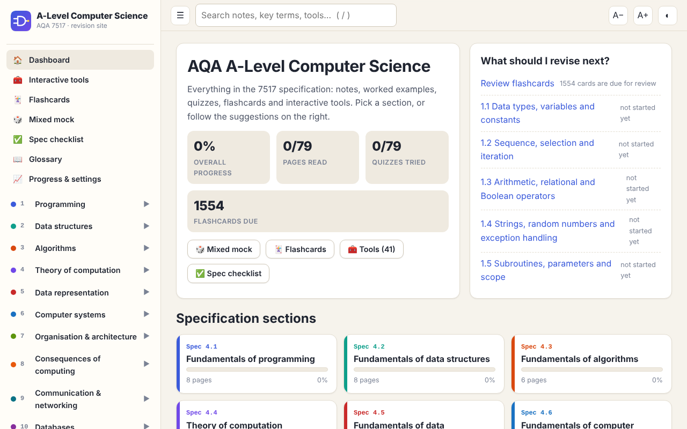
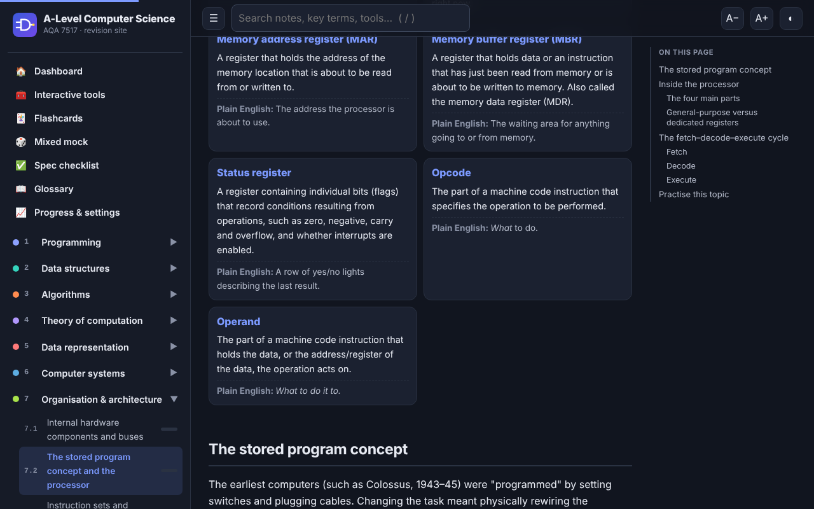
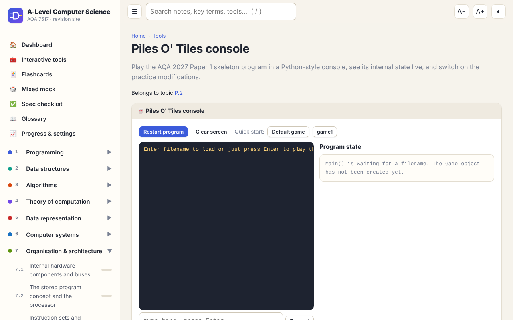

# A-Level Computer Science Revision Site (AQA 7517)

A complete, interactive revision website for the AQA A-Level Computer Science specification. I designed it and built it with an AI coding agent: I wrote the requirements and quality bar, and directed and reviewed the work. Every page, question and tool was produced by Claude Code agents and then checked by automated tests and independent AI reviewers.

**Live site:** https://h4rvb0x.github.io/computing-notes/



## What's in it

| | |
|---|---|
| **79 pages of notes** | Every section of the AQA 7517 specification. Each page has learning objectives, key terms (mark-scheme wording plus plain English), worked examples, diagrams, "Marks are lost here" boxes, exam technique and a recap |
| **283 / 283 spec points** | Each mapped to the page that teaches it ([COVERAGE.md](COVERAGE.md)) |
| **1,585 quiz questions** | Multiple choice, short answer, true/false, ordering and spot-the-bug, all with explanations |
| **584 exam-style questions** | Self-marked against mark schemes, including 9- and 12-mark levelled questions |
| **700+ flashcards** | Spaced repetition (Leitner boxes) |
| **89 trace-table challenges** | Checked cell by cell |
| **41 interactive tools** | Including an AQA assembly simulator, fetch–decode–execute stepper, logic-gate simulator, Boolean simplifier, SQL playground, floating-point explorer, Dijkstra/A* visualiser, Turing machine, FSM and regex tools, subnet calculator and a TLS handshake demo |
| **Paper 1 skeleton section** | For the 2027 "Piles O' Tiles" program: a method-by-method code tour, 18 documented bugs, 58 Section C questions, 21 Section D modification tasks with tested model answers, and a faithful in-browser port of the game |
| **Study tools** | Progress tracking, weakest-topic suggestions, a timed mixed mock, a spec checklist, search, dark/light mode, mobile layout, per-page reset and a "don't save on this device" mode |

<p>
  
  
</p>

## How it was built: AI-assisted engineering

This project is mainly an exercise in **directing AI agents to build something large and correct**, rather than writing every line by hand.

**My role**
- Defined the product: what a textbook replacement needs, the page template, question types, tools, accessibility, offline use and the quality bar.
- Supplied the source material (my class notes, kept private and not in this repo) and the exam-board constraints, and made the design decisions: logo, privacy, memory controls, hosting.
- Ran the build: reviewed reports, re-prioritised, and kept the work inside a limited usage budget (at most two agents at a time).

**How the AI work was organised**
- **Specification first.** A written content contract ([docs/CONTENT_SPEC.md](docs/CONTENT_SPEC.md)) gave every agent the same formats and quality rules.
- **Parallel agents.** Claude Code sub-agents each owned a section of the course or a group of tools, working in the same repository.
- **Verification over trust.** No content was accepted on the AI's word:
  - Every Python example is executed, and its output is compared with what the page shows (188 examples).
  - Every quiz key, trace and mark scheme was recomputed with code: Python, `sqlite3`, `re`, logic identities checked against every input, an AQA assembly interpreter.
  - The skeleton-program console was **differentially tested** against the real Python program: 61 scripted runs with identical output.
  - A Playwright smoke test opens all 416 routes (desktop and mobile) and fails on any console error, missing tool or horizontal scroll.
- **Independent review.** Every page was re-checked by a separate reviewer agent that hadn't written it. About 25 errors were caught and fixed, for example a wrong Amdahl's-law figure, AQA's definition of image resolution, and a logic puzzle with two answers.
- **Source correction.** Mistakes found in the original notes (textbook, slides, online resources) are corrected on the pages and flagged for students.
- **Continuous checks.** A GitHub Actions workflow re-runs the validators on every push before deploying.

## Tech

- Plain **HTML, CSS and vanilla JavaScript**: no framework, no build step, no dependencies. It runs from `file://` or any static host.
- A hash-based single-page router; content is written as **Markdown inside JS files** with a small custom renderer (callouts, tabs, steps, inline SVG diagrams, embedded tools).
- Progress is stored in `localStorage`, with export/import.
- Python and Node scripts handle validation, coverage generation and end-to-end testing.

```
site/        the website (this folder is what GitHub Pages publishes)
  index.html, css/, js/          app shell, router, renderer, quiz/flashcard/trace engines
  content/                       sections.js (site map + spec points), topics, quizzes, exams, flashcards, traces
  tools/                         one file per interactive tool
scripts/     build_manifest, check_content, run_python_snippets, build_coverage, smoke_test
docs/        authoring guide, developer guide, accounts plan, coverage notes, screenshots
COVERAGE.md  every AQA spec point → page → status
```

## Run it locally

Open `site/index.html` in a browser. No server needed.

To check content after editing, from the repository root:

```bash
python3 scripts/build_manifest.py      # after adding files
python3 scripts/check_content.py       # schema, links, required blocks
python3 scripts/run_python_snippets.py # run every Python example
python3 scripts/build_coverage.py      # regenerate COVERAGE.md
node scripts/smoke_test.js             # needs the playwright npm package
```

See [docs/DEVELOPING.md](docs/DEVELOPING.md) for how to add pages, questions and tools.

## Deploying to GitHub Pages

1. Repository **Settings → Pages → Build and deployment → Source: GitHub Actions**.
2. Push to `main`. The workflow in `.github/workflows/pages.yml` validates the content, then publishes `site/`.

## Roadmap

- Accounts and cross-device sync with Firebase and Google sign-in ([docs/accounts-plan.md](docs/accounts-plan.md)).
- An optional class leaderboard.

## Notes

- Not affiliated with or endorsed by AQA. Specification references are for revision purposes.
- The Paper 1 skeleton section is based on AQA's 2027 preliminary material, which is intended for candidates at the centre.
